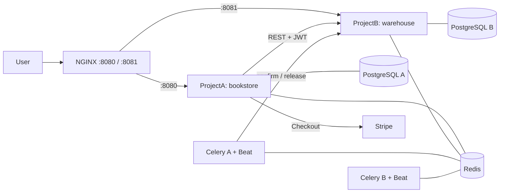

# BookStore Platform

Two independent Django projects that talk to each other over a REST API:

- **ProjectA (`project_a`)** is the bookstore: catalog, cart, orders and Stripe payments.
- **ProjectB (`project_b`)** is the warehouse service: book stock, reservations for orders and a stock movement journal.


## Contents

- [Tech stack](#tech-stack)
- [Architecture](#architecture)
- [How the services communicate](#how-the-services-communicate)
- [Quick start](#quick-start)
- [Environment variables](#environment-variables)
- [Project structure](#project-structure)
- [ProjectA details](#projecta-details)
- [ProjectB details](#projectb-details)
- [Tests](#tests)
- [CI/CD](#cicd)
- [Settings structure](#settings-structure)
- [Deployment (Render)](#deployment-render)
- [Live demo](#live-demo)
- [AI Usage](#ai-usage)

## Tech stack

| Area | Implementation |
|---|---|
| Framework | Django 6, Django REST Framework |
| Database | PostgreSQL (one database per service) |
| Cache and broker | Redis |
| Background tasks | Celery worker and Celery Beat in both services |
| Web server | Gunicorn behind NGINX |
| Authentication | Custom User Model (login by phone number), JWT (simplejwt) |
| Authorization | Django permissions and groups, DRF permission classes |
| Views | Django views and DRF ViewSets with mixins (inheritance) |
| i18n | ProjectA: English, Ukrainian, Polish. ProjectB: English, Ukrainian |
| UI | Bootstrap templates (ProjectA) |
| API docs | OpenAPI and Swagger UI (drf-spectacular) in both services |
| Monitoring | Sentry (Django and Celery integrations) |
| Containers | Docker, Docker Compose |
| Quality | pytest, coverage, flake8, black, GitHub Actions |

## Architecture



Redis is shared, but the logical databases are separate: ProjectA uses db 0, 1 and 2, ProjectB uses db 3 and 4. Each project has its own PostgreSQL database.

## How the services communicate

1. **Checkout.** In `order_create` the bookstore creates the `Order` and calls `POST /api/v1/reservations/` on the warehouse inside the same database transaction. If the stock is not enough (`409 insufficient_stock`) or the warehouse is unavailable, the order is rolled back and the user sees an error message.
2. **Payment.** After Stripe confirms the payment (webhook `checkout.session.completed` or the success page), the Celery task `orders.tasks.confirm_reservation` calls `POST /api/v1/reservations/{order_id}/confirm/`. The warehouse writes the books off. The task is retried with exponential backoff if the warehouse is unavailable.
3. **Cancel or no payment.** The task `orders.tasks.release_reservation` gives the books back. Unpaid reservations are also released by the warehouse itself when their TTL expires (Celery Beat, every 5 minutes).
4. **Idempotency.** A reservation is identified by the order id, so repeated requests are safe.

### Service-to-service authentication

The bookstore logs in to the warehouse as a service user (group `service_accounts`, logs in with a phone number) on `POST /api/token/` and caches the access token in Redis. When the warehouse answers `401`, the token is refreshed once and the request is repeated.

The client is `project_a/services/warehouse_client.py`. It has timeouts, error handling and logging, and raises dedicated exceptions: `OutOfStock`, `WarehouseUnavailable`, `WarehouseNotFound` and `InvalidReservationState`.

## Quick start

Docker and Docker Compose are required.

```bash
# 1. Environment files (fill in the values)
cp .env.example .env # WAREHOUSE_SERVICE_USER, WAREHOUSE_SERVICE_PASSWORD
cp project_a/.env.example project_a/.env
cp project_b/.env.example project_b/.env

# 2. Start all services
docker compose up --build

# 3. Load the initial stock into the warehouse (in another terminal)
docker compose exec project_a python manage.py sync_stock --quantity 10
```

Migrations, `collectstatic` and the creation of the service user run automatically on start.

| What | URL |
|---|---|
| Bookstore | http://localhost:8080 |
| Bookstore API docs (Swagger) | http://localhost:8080/api/docs/ |
| Warehouse API docs (Swagger) | http://localhost:8081/api/docs/ |
| Warehouse admin | http://localhost:8081/admin/ |

Create an admin account with `docker compose exec project_a python manage.py createsuperuser` (the same for `project_b`).

After changing code, rebuild the images: `docker compose up --build -d`.

## Environment variables

| Variable | Purpose |
|---|---|
| `SECRET_KEY` | Django secret key (separate for each project) |
| `DJANGO_SETTINGS_MODULE` | Settings module (`development` or `production`) |
| `DATABASE_URL` | PostgreSQL connection |
| `REDIS_URL` | Redis for cache and Celery |
| `STRIPE_SECRET_KEY`, `STRIPE_PUBLISHABLE_KEY`, `STRIPE_WEBHOOK_SECRET` | Payments (ProjectA) |
| `WAREHOUSE_SERVICE_URL`, `WAREHOUSE_AUTH_URL` | Warehouse API and token URLs (ProjectA) |
| `WAREHOUSE_SERVICE_USER`, `WAREHOUSE_SERVICE_PASSWORD` | Service account (phone number and password) |
| `ALLOWED_HOSTS` | Allowed hosts (`project_b` is added for ProjectB in Docker) |
| `CSRF_TRUSTED_ORIGINS` | Trusted origins in production |
| `RUN_MIGRATIONS` | `1` runs migrations and collectstatic when the container starts |
| `CELERY_ALWAYS_EAGER` | `1` runs tasks inside the web process (no worker) |
| `SENTRY_DSN`, `SENTRY_ENABLED`, `SENTRY_ENVIRONMENT` | Monitoring |

Never commit real `.env` files. The repository contains only `.env.example` templates.

## Project structure

```
bookstoreplatform/
├── docker-compose.yml
├── .env.example
├── project_a/ # bookstore
│ ├── DjangoBookStore/ # project package and settings/
│ ├── books/ categories/ users/ orders/
│ ├── api/ # REST API
│ ├── services/ # warehouse client
│ ├── nginx/default.conf
│ └── Dockerfile
└── project_b/ # warehouse
 ├── warehouse/ # project package and settings/
 ├── users/ stock/ api/
 └── Dockerfile
```

## ProjectA details

### Caching (Redis)

- **View cache:** catalog page (`cache_page`, 60 s, separate `pages` cache).
- **Template fragment:** categories select (300 s, the key includes the language, the current category and a version number).
- **Low-level cache:** book detail object (`book:<id>`, 15 minutes).
- **Invalidation:** signals (`books/signals.py`) clear the book cache and the catalog pages when a book or a category is saved or deleted (after the transaction commits). The categories fragment is invalidated by changing its version key.

### Background tasks (Celery)

| Task | Description | Schedule |
|---|---|---|
| `orders.tasks.send_order_confirmation` | Order confirmation email, retried on mail errors | on order creation |
| `orders.tasks.confirm_reservation` | Confirms the warehouse reservation after payment, retried when the warehouse is down | after payment |
| `orders.tasks.release_reservation` | Releases the reservation of a canceled order | on cancel |
| `orders.tasks.generate_daily_report` | CSV report of paid orders, saved to `reports/` | daily 23:55 |
| `users.tasks.clear_expired_sessions` | Removes expired sessions | daily 03:00 |

Without `REDIS_URL` (local run, tests) the tasks are executed synchronously.

### REST API

Built with Django REST Framework. Interactive documentation (Swagger): `/api/docs/`, ReDoc: `/api/redoc/`, OpenAPI schema: `/api/schema/`.

| Endpoint | Description | Access |
|---|---|---|
| `/api/books/` | Books (filters, search, ordering) | read: everyone, write: admin |
| `/api/categories/` | Categories with books count | read: everyone, write: admin |
| `/api/orders/` | Orders with nested items | authenticated, owner only |
| `/api/cart/` | Session cart | everyone |
| `/api/register/` | Registration | everyone |
| `/api/token/` | JWT (obtain, refresh) | everyone |
| `/api/me/` | Current user | authenticated |

- Pagination: 20 items per page (`?page=2`)
- Filters: django-filter, search and ordering parameters
- Throttling: 100 requests/hour for anonymous, 1000/hour for authenticated users
- Authorization: JWT (`Authorization: Bearer <access token>`) or session
- Permissions: `IsOwnerOrReadOnly` and others (see `api/permissions.py`)
- CORS: allowed origins are set in `settings/base.py`

### Health check

`GET /health/` returns `200 {"status": "ok", "database": "ok", "cache": "ok"}`, or `503` if the database or the cache is not available.

### Monitoring (Sentry)

Errors from Django and Celery are sent to Sentry when `SENTRY_DSN` is set and `SENTRY_ENABLED=1`.

## ProjectB details

### API

Interactive documentation: `/api/docs/` (Swagger), `/api/redoc/`, `/api/schema/`. All endpoints require a JWT access token from `POST /api/token/`.

| Endpoint | Description | Permission |
|---|---|---|
| `GET /api/v1/stock/` | Stock levels (filter, search, ordering) | `view_stockitem` |
| `GET /api/v1/stock/{book_id}/` | Stock of one book | `view_stockitem` |
| `POST /api/v1/stock/{book_id}/receive/` | Register a delivery | `adjust_stock` |
| `GET /api/v1/reservations/` | List of reservations | `view_reservation` |
| `GET /api/v1/reservations/{order_id}/` | One reservation | `view_reservation` |
| `POST /api/v1/reservations/` | Reserve books for an order (idempotent) | `reserve_stock` |
| `POST /api/v1/reservations/{order_id}/confirm/` | Order paid: books leave the warehouse | `reserve_stock` |
| `POST /api/v1/reservations/{order_id}/release/` | Order canceled: books become available | `reserve_stock` |

Errors are mapped to clear HTTP codes by a custom exception handler (`api/errors.py`): `409` with code `insufficient_stock` or `invalid_state`, `404` for unknown reservations or books, `400` for invalid adjustments.

### Domain model

- `StockItem`: `on_hand` and `reserved` quantity of a book (identified by the book id from ProjectA). A database constraint guarantees `reserved <= on_hand`.
- `Reservation` and `ReservationItem`: books held for one order, with a TTL (`RESERVATION_TTL_MINUTES`).
- `StockMovement`: journal of every change (receive, reserve, release, ship, adjust) with the user who made it.

All stock changes run in transactions with `select_for_update`, so parallel orders cannot oversell a book.

### Background tasks (Celery)

| Task | Description | Schedule |
|---|---|---|
| `stock.tasks.expire_reservations` | Releases unpaid reservations whose time is over | every 5 minutes |
| `stock.tasks.generate_daily_report` | Daily stock report | daily 23:50 |

### Permissions and groups

Custom permissions: `reserve_stock`, `adjust_stock`, `view_reports`. The service account used by ProjectA belongs to the group `service_accounts` (created by `python manage.py create_service_user`). The language of the interface can be English or Ukrainian.

## Tests

```bash
cd project_a && pytest # 170 tests, coverage about 98%
cd project_b && pytest # 46 tests, coverage about 92%
```

The suites contain unit, integration and API tests (`APIClient`). The warehouse client in ProjectA is tested with `responses` (success, token refresh, `409`, `404`, `5xx`, timeouts, connection errors). The required coverage is at least 90% in CI (`--cov-fail-under=90`).

## CI/CD

GitHub Actions (`.github/workflows/platform.yml`) runs on every push and pull request that touches `bookstoreplatform/`:

1. **Lint:** `flake8` and `black --check` for both projects.
2. **Tests:** `pytest` with coverage (fails below 90%) for both projects.
3. **Docker:** on push to `main`, if the previous jobs passed, both images are built and pushed to Docker Hub (`latest` and the commit SHA tags).

Docker images: `<DOCKERHUB_USER>/bookstore-a` and `<DOCKERHUB_USER>/warehouse-b`.

## Settings structure

Both projects use the same layout:

| File | Purpose |
|---|---|
| `settings/base.py` | Common settings for all environments |
| `settings/development.py` | `DEBUG=True`, used by `manage.py`, pytest and local Docker Compose |
| `settings/production.py` | `DEBUG=False`, HTTPS redirect, secure cookies, HSTS, WhiteNoise |

The module is selected with `DJANGO_SETTINGS_MODULE`. Secrets are read from environment variables (a local `.env` file is used in development, see `.env.example`).

Static files are served by WhiteNoise in production and by NGINX in Docker Compose. HSTS `include_subdomains` and `preload` are intentionally off: on a platform domain the subdomains are not ours.

## Deployment (Render)

| Service | Type | Notes |
|---|---|---|
| `djangobookstore` | Web Service (Docker) | Root directory `DjangoBookStore`, health check `/health/` |
| `bookstore-db` | PostgreSQL | `DATABASE_URL` (internal URL) |
| `bookstore-cache` | Key Value | `REDIS_URL` (internal URL) |

Required environment variables: `DJANGO_SETTINGS_MODULE`, `SECRET_KEY`, `ALLOWED_HOSTS`, `CSRF_TRUSTED_ORIGINS`, `DATABASE_URL`, `REDIS_URL`, `RUN_MIGRATIONS=1` and `STRIPE_*`. To connect to the warehouse, ProjectA also needs `WAREHOUSE_SERVICE_URL`, `WAREHOUSE_AUTH_URL`, `WAREHOUSE_SERVICE_USER` and `WAREHOUSE_SERVICE_PASSWORD` that point to the public address of ProjectB.

On the free tier there is no background worker, so Celery tasks run inside the web process (`CELERY_ALWAYS_EAGER=1`). Migrations, collectstatic, the admin account and demo data are handled by `docker-entrypoint.sh` on start. The free Render database expires 30 days after creation.

## Live demo

Deployed on Render (free tier, the first request after a pause can take about a minute):

- Bookstore: https://djangobookstore-ijxo.onrender.com
 - Health check: `/health/`
 - API docs (Swagger): `/api/docs/`
- Warehouse: `<WAREHOUSE_URL>` (API docs: `/api/docs/`)

## AI Usage

AI (Claude) was used in this project for the following:

1. **Code review.** Three complex views were reviewed: `order_success`, `stripe_webhook` and `ManagerUserPermissionsView`. The original code, the AI recommendations, the decisions (applied or rejected) and the final code are described in `AI_REVIEW.md`. Main results: payment verification before marking an order as paid, a fixed Stripe webhook (CSRF, idempotency), fewer SQL queries on the permissions page.
2. **Test generation.** AI generated tests for the models and views. Every generated test was run, reviewed and modified, and is marked with the comment `# Generated with AI, reviewed and modified`. Several tests found real bugs in the code (for example, `Cart.clear()` did not clear the cart).
3. **Documentation.** Docstrings for all views and this README were written with AI help and then checked against the code.
4. **Platform integration.** AI helped to design the REST integration between the two services (client, Celery tasks, Docker Compose, CI) and to review the generated code.

All prompts are listed in `AI_PROMPTS.md`.

What AI got wrong or needed checking: some advice had to be rejected (for example, forbidding managers to edit their own permissions was considered out of scope), and generated tests needed fixes (field names, order of mock arguments, fixtures). Generated code copied from chat also had to be checked for broken characters (for example, quotes and spaces inside URL paths). AI output was never accepted without running the tests.